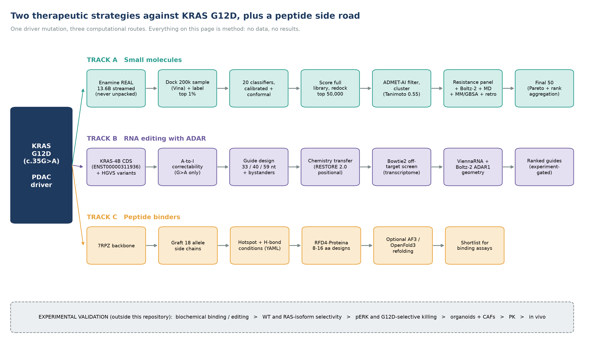
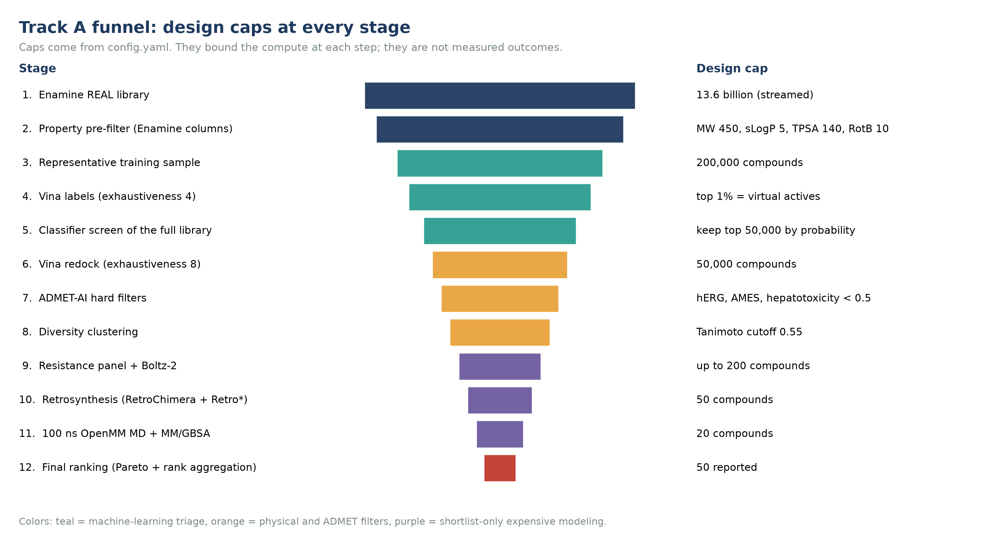
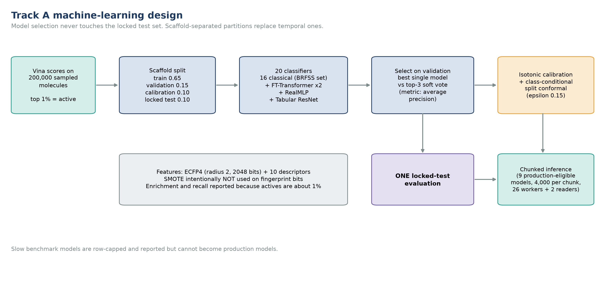
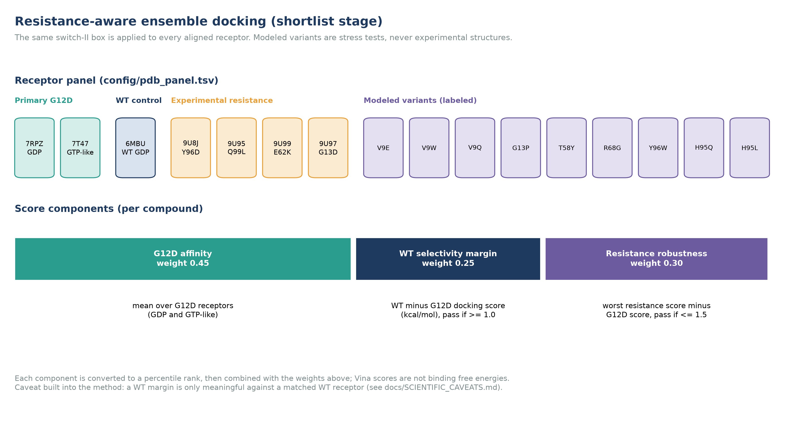
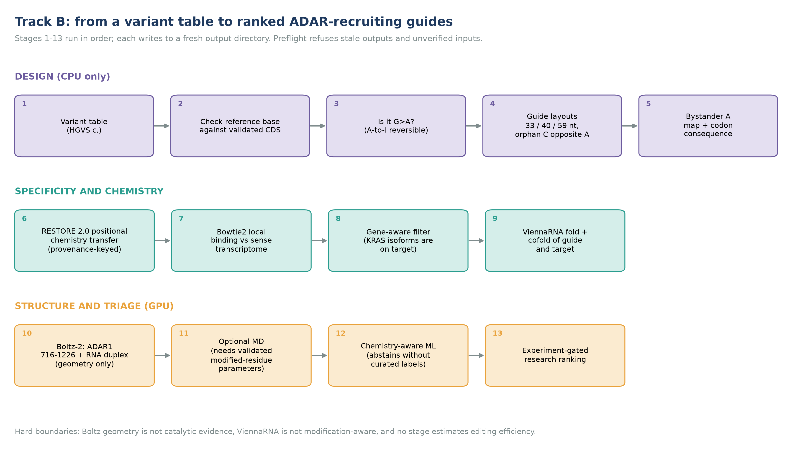
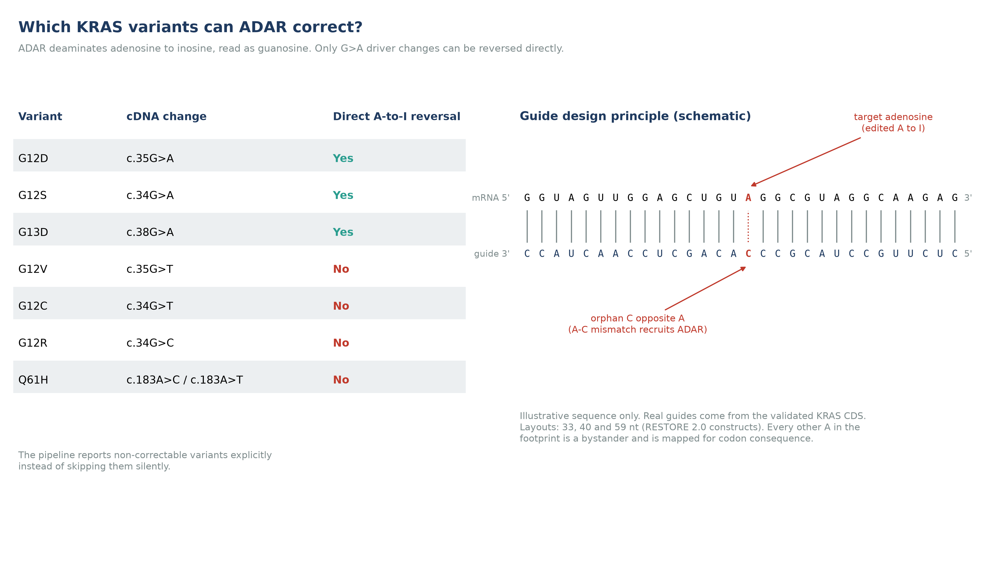
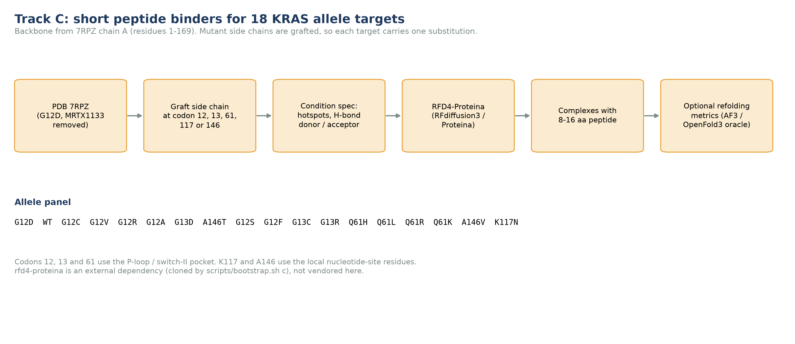
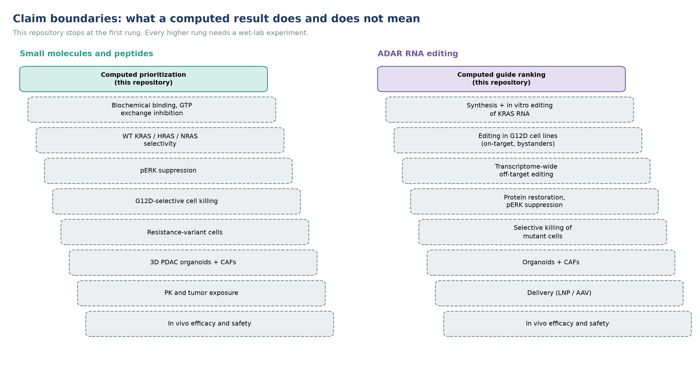

# Two Therapeutic Strategies to Target KRAS Mutants

### An open, end-to-end computational platform that screens 13.6 billion molecules *and* designs ADAR RNA editors against the same pancreatic cancer driver


> **13.6 billion molecules. One mutation. Two ways to attack it.**
>
> Oncogenic KRAS mutations sit in roughly nine of ten pancreatic ductal adenocarcinomas (PDAC), G12D is the most frequent variant, and for decades KRAS was called undruggable.
> This repository gives you the complete computational playbook for two independent routes to the same target:
> **(A)** find a small molecule in the largest purchasable chemical space on Earth, and
> **(B)** skip the protein entirely and recode the mutant *mRNA* with the cell's own editing enzyme, ADAR.
> A third lane (**C**) designs short peptide binders for 18 KRAS alleles.

Every stage is scripted, parameterized and gated. Every claim boundary is written down. **No data, no results, no patient material ships in this repository**: only code, configuration, documentation, figures and tables describing the method.



*Figure 1. The platform at a glance. All figures are method schematics generated by [`docs/figures/make_figures.py`](docs/figures/make_figures.py); they contain no results.*

---

## Why this is worth your time

| | |
|---|---|
| **Truly ultra-large** | Streams Enamine REAL shards straight from `.cxsmiles.bz2` (never decompressed), trains on a 200,000-molecule docked sample, then lets a calibrated ML ensemble score the whole library. |
| **ML you can audit** | 20 classifiers, scaffold-separated splits, validation-only model selection, isotonic calibration, class-conditional conformal prediction, **one** locked-test evaluation. |
| **Resistance-aware from day one** | The shortlist is re-docked across 7 experimental and 9 modeled KRAS resistance receptors plus a wild-type counter-screen, then ranked on affinity, selectivity and robustness. |
| **A second modality, same rigor** | ADAR guide design with A-to-I correctability checks, bystander maps, chemistry transfer with provenance keys, Bowtie2 transcriptome off-target screening, ViennaRNA and Boltz-2 geometry. |
| **Honest by construction** | Preflight gates refuse stale outputs, demo data and unverified inputs. Stages abstain instead of guessing. Figure 8 shows exactly where computation ends and biology begins. |
| **One-command wrappers** | `bootstrap.sh`, `fetch_public_inputs.sh`, `run_track_{a,a2,b,c}.sh` and a single `run_all.sh`. |

## The tracks

| Track | Modality | What it does | Run it |
|---|---|---|---|
| **A** | Small molecules | ML-guided ultra-large docking, ADMET, resistance panel, Boltz-2, MD, MM/GBSA, retrosynthesis, Pareto ranking | `scripts/run_track_a.sh screen --library PATH` |
| **A2** | Small molecules (light) | Ten-script ensemble-docking triage for up to about 1e5 molecules | `scripts/run_track_a2.sh` |
| **B** | ADAR RNA editing | Variant to ranked ADAR-recruiting guide RNAs, with off-target and structure stages | `scripts/run_track_b.sh plan` |
| **C** | Peptides | RFdiffusion3 / Proteina designs for 18 KRAS allele targets | `scripts/run_track_c.sh design` |



*Figure 2. Track A funnel. Numbers are design caps from `config.yaml`, not outcomes.*

## Quickstart

```bash
git clone https://github.com/truong128/two-strategies-to-target-kras-mutants.git
cd two-strategies-to-target-kras-mutants

scripts/bootstrap.sh                 # conda environments + external tools (RFD4-Proteina)
scripts/fetch_public_inputs.sh       # 7RPZ receptor, Ensembl 113, ADAR1, KRAS CDS, allele targets
scripts/run_all.sh smoke             # regression tests: no GPU, no data needed

scripts/run_track_b.sh preflight     # verify every Track B input
scripts/run_track_b.sh plan          # ADAR guide design (CPU)
scripts/run_track_a.sh screen --library /path/to/enamine_real   # the big one
```

Requirements: Linux, conda or mamba (Miniforge), git, [Nextflow](https://www.nextflow.io), an NVIDIA GPU for Boltz-2, MD and Track C. Details in [`docs/INSTALL.md`](docs/INSTALL.md). The Enamine library and a few other inputs cannot be redistributed; [`docs/DATA_ACCESS.md`](docs/DATA_ACCESS.md) says where to get each one.

## Track A in one picture: how the classifier is built



*Figure 3. Model selection never touches the locked test set. SMOTE is intentionally not used on fingerprint bits.*



*Figure 4. Resistance-aware ensemble docking on the shortlist.*

## Track B in one picture: from a variant to a guide



*Figure 5. Thirteen ordered stages. Each writes to a fresh directory and the preflight refuses stale inputs.*



*Figure 6. Only G>A driver changes (G12D, G12S, G13D) are directly reversible by A-to-I editing. The sequence in the schematic is illustrative.*

## Track C



*Figure 7. `rfd4-proteina` is cloned by `scripts/bootstrap.sh c` as an external dependency; it is not vendored here.*

## Where computation stops



*Figure 8. This repository delivers the first rung of each ladder. Docking, machine learning, MD, MM/GBSA, Boltz-2 and ViennaRNA prioritize; they do not validate.*

## Tables

All tables are generated from the shipped configuration by [`docs/make_tables.py`](docs/make_tables.py) and collected in [`docs/tables/TABLES.md`](docs/tables/TABLES.md):

| # | Table |
|---|---|
| T1 | Tracks, purpose and entry points |
| T2 | Track A stages (one row per Nextflow process) |
| T3 | Track A ranking weights |
| T4 | Resistance receptor panel (7 experimental, 9 modeled) |
| T5 | KRAS allele panel (18 alleles) |
| T6 | Track B stages |
| T7 | Which KRAS variants ADAR can reverse directly |
| T8 | Track C allele targets and pocket definitions |
| T9 | Software stack and tested versions |
| T10 | Inputs that are not in this repository, and how to get them |
| T11 | Compute guide |
| T12 | Known limitations built into the method |

## Repository map

```text
two-strategies-to-target-kras-mutants/
  README.md                        you are here
  docs/
    INSTALL.md                     environments, GPUs, external tools
    STEP_BY_STEP.md                every step of every track, with commands, inputs and outputs
    DATA_ACCESS.md                 what is NOT included and where to obtain it
    SCIENTIFIC_CAVEATS.md          limits of the method, in plain language
    PUSH_TO_GITHUB.md              publish this repository
    figures/                       make_figures.py + PNG + SVG
    tables/                        T1..T12 as CSV, and TABLES.md
    make_tables.py
  scripts/                         bootstrap, fetch_public_inputs, run_track_*, run_all, check_release
  tracks/
    a_small_molecule_discovery/    Nextflow main.nf, config.yaml, scripts/
    a2_ensemble_docking_triage/    scripts 00 to 09
    b_adar_rna_editing/            guide design, off-target, structure, tests
    c_peptide_binders/             target builder + RFD4 launcher
```

## What is deliberately missing

Raw or processed results, trained models, docked poses, trajectories, ranked compound lists, guide sequences from real runs, patient or cell-line data, vendor libraries, third-party weights and publisher supplements. `.gitignore` blocks them by pattern and `scripts/check_release.sh` fails the push if any slip through. This keeps the repository small, legally clean and safe to share before your own results are published.

## Reproducibility and honesty

- Seeds, thresholds and weights live in config files, not in code.
- Workflows are resumable (`nextflow -resume`) and every Track B run needs a new output directory.
- Modeled structures are labeled `MODEL_*` everywhere; transferred chemistry carries provenance keys; stages that lack validated inputs abstain and say so.
- A computed rank is a hypothesis. The path from here to a drug or a therapy is Figure 8.

## Cite

If this platform helps your work, please cite the repository (see [`CITATION.cff`](CITATION.cff)) and the underlying tools listed in [`tracks/a_small_molecule_discovery/REFERENCES.md`](tracks/a_small_molecule_discovery/REFERENCES.md) (AutoDock Vina, Meeko, ADMET-AI, Boltz-2, OpenMM, AmberTools, RetroChimera, Syntheseus, ViennaRNA, Bowtie2, RFD4-Proteina) and the RESTORE 2.0 publication used for chemistry transfer.

## License

Code in this repository is released under the [MIT License](LICENSE). The exceptions are **Enamine REAL** and the **RESTORE 2.0 supplementary data**: they are not included, are not covered by this license, and follow the terms of their original releases. Other third-party tools and model files are not redistributed here either; you obtain them from upstream, and their own licenses apply (see [`docs/DATA_ACCESS.md`](docs/DATA_ACCESS.md)).

## Disclaimer

Research use only. Nothing here establishes binding, editing, selectivity, safety or efficacy, and nothing here is medical advice.
